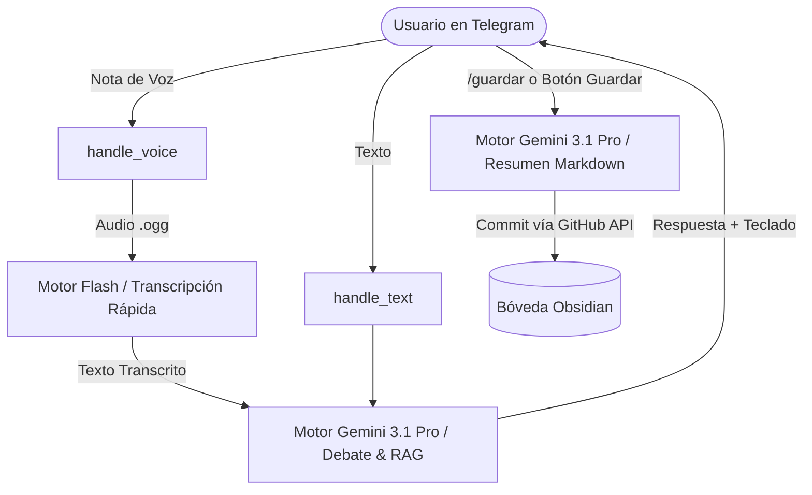

# Plan de Integración de Gemini 3.1 Pro (Google AI Studio) en Cerebro-Bot

**Estado:** Propuesta Técnica / En Revisión  
**Objetivo:** Migrar el motor de inteligencia de `cerebro-bot` desde el modelo básico (`gemini-3.5-flash-lite`) al modelo insignia de desarrollo (`gemini-3.1-pro`), aprovechando los límites y beneficios del plan de Google AI Studio.

---

## 1. Diagnóstico del Estado Actual

En el código actual:
1. **Modelo Fijo en Código:** En [`core/ai.py`](file:///home/emerson/Documents/Projects/cerebro-bot/core/ai.py#L11), está hardcodeado:
   ```python
   MODEL_NAME = 'gemini-3.5-flash-lite'
   ```
2. **Uso Monolítico:** Se usa el mismo modelo ligero para transcribir audio, para debatir ideas y para resumir en Markdown.
3. **Telemetría Desalineada:** En [`core/telegram.py`](file:///home/emerson/Documents/Projects/cerebro-bot/core/telegram.py#L195), el comando `/estado` muestra fijamente `gemini-3.5-flash-lite` sin leer la configuración activa.
4. **Manejo de Latencia:** Los modelos Pro tienen mayor profundidad de razonamiento pero una latencia ligeramente superior (2.5s - 4.5s vs 0.8s de Flash). En Telegram, si no se envía la acción `typing` periódicamente, el usuario percibe que el bot no respondió.

---

## 2. Decisión de Arquitectura: Estrategia Híbrida Inteligente

> [!IMPORTANT]
> **Recomendación Senior:** No conviene usar el modelo Pro para transcribir notas de voz.
> * Transcribir un archivo de audio de 30 segundos con `gemini-3.1-pro` tarda entre 4 y 7 segundos sin aportar ganancia de precisión sobre Flash.
> * Con Flash-Lite/Flash la transcripción tarda ~1.2 segundos.
> * **Arquitectura Propuesta:**
>   * **Capa de Transcripción:** `gemini-2.5-flash` o `gemini-3.5-flash-lite` (Ultra rápido).
>   * **Capa de Ideación, Debate y RAG:** `gemini-3.1-pro` (Máximo razonamiento, arquitectura y preguntas inteligentes).
>   * **Capa de Síntesis Markdown para Obsidian:** `gemini-3.1-pro` (Estructura superior, taxonomía y detección de relaciones).



---

## 3. Plan de Cambios por Archivo

### 1. [`core/config.py`](file:///home/emerson/Documents/Projects/cerebro-bot/core/config.py)
* Añadir soporte de variables de entorno configurables con fallbacks:
  ```python
  GEMINI_PRO_MODEL = os.getenv("GEMINI_PRO_MODEL", "gemini-3.1-pro")
  GEMINI_FAST_MODEL = os.getenv("GEMINI_FAST_MODEL", "gemini-2.5-flash")
  ```

### 2. [`core/ai.py`](file:///home/emerson/Documents/Projects/cerebro-bot/core/ai.py)
* **Separación de modelos:**
  * `process_audio_to_text()`: Usar `GEMINI_FAST_MODEL`.
  * `get_or_create_chat()`: Inicializar la sesión con `GEMINI_PRO_MODEL`.
  * `generate_final_markdown()`: Resumir con `GEMINI_PRO_MODEL`.
* **Configuración del modelo Pro:**
  * Ajustar `temperature` (0.7 para ideación, 0.2 para resúmenes Obsidian).
  * Optimizar `system_instruction` para aprovechar la capacidad de razonamiento de Pro.

### 3. [`core/telegram.py`](file:///home/emerson/Documents/Projects/cerebro-bot/core/telegram.py)
* **Feedback de escritura (*Chat Action*):** Enviar `context.bot.send_chat_action(chat_id, action="typing")` mientras Gemini 3.1 Pro procesa consultas largas o búsquedas RAG.
* **Comando `/estado`:** Actualizar dinámicamente el nombre del modelo activo leyendo de `core.config.GEMINI_PRO_MODEL`.
* **Manejo de Errores y Rate-Limits:** Capturar códigos de estado específicos de la API (429/503) con reintento automático exponencial de 1 intento antes de fallar.

---

## 4. Guía para Configurar tu API Key de Google AI Studio

Para que el bot use la cuota de tu plan pagado:

1. Ve a [Google AI Studio (aistudio.google.com)](https://aistudio.google.com).
2. Asegúrate de iniciar sesión con la **misma cuenta de Google que tiene el plan contratado**.
3. Haz clic en **Get API Key** -> **Create API Key**.
4. Selecciona un proyecto de Google Cloud o crea uno nuevo vinculado a tu cuenta.
5. Copia la clave generada y actualízala:
   * **Localmente:** En tu archivo `.env`:
     ```env
     GEMINI_API_KEY=tu_api_key_de_ai_studio
     GEMINI_PRO_MODEL=gemini-3.1-pro
     GEMINI_FAST_MODEL=gemini-2.5-flash
     ```
   * **En Producción (Render):** En el panel de Render -> *Environment Variables* -> Editar `GEMINI_API_KEY`.

---

## 5. Plan de Verificación

| Caso de Prueba | Acción | Resultado Esperado |
| :--- | :--- | :--- |
| **Prueba de Transcripción** | Enviar nota de voz de 10s | Transcrita en < 2s usando el modelo Flash. |
| **Prueba de Debate Pro** | Preguntar: *"Compara arquitectura hexagonal vs vertical slice en FastAPI"* | Respuesta analítica profunda generada por `gemini-3.1-pro`. |
| **Prueba de Guardado en Bóveda** | Ejecutar `/guardar` | Documento Markdown con frontmatter correcto inyectado en GitHub. |
| **Prueba de Comando `/estado`** | Ejecutar `/estado` en Telegram | Muestra `Modelo Activo: gemini-3.1-pro`. |
