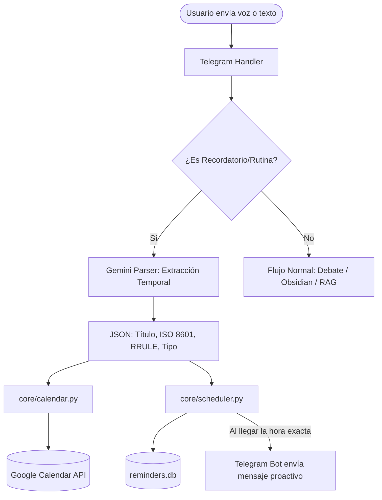

# Plan de Arquitectura e Integración: Recordatorios y Rutinas (Google Calendar + Telegram)

**Estado:** Aprobado en Planificación / Pendiente de Credenciales Google Cloud  
**Fecha:** 2026-10-15  
**Objetivo:** Permitir al usuario crear recordatorios puntuales (*"recuérdame a las 5pm llamar al médico"*) y rutinas recurrentes (*"recuérdame todos los días a las 8am tomar café"*) mediante notas de voz o texto, sincronizándolos automáticamente con Google Calendar y disparando alertas proactivas tanto en móvil/reloj como en el chat de Telegram.

---

## 1. Decisiones Arquitectónicas Confirmadas

1. **Estrategia de Doble Notificación (Ambos Canales):**
   * **Canal 1 (Google Calendar):** Crea el evento en el calendario de Google con alarmas emergentes nativas (`popup` / push en smartwatch y smartphone Android/iOS).
   * **Canal 2 (Telegram Bot Proactivo):** En el minuto programado, el bot envía un mensaje directo al usuario en Telegram:  
     `🔔 ¡RECORDATORIO!: [Tarea programada]`
2. **Zona Horaria del Sistema:** Fija en `America/Bogota` (UTC-5). Todo cálculo relativo ("hoy a las 4pm", "en 20 minutos", "mañana a las 9am") se normaliza contra esta zona.
3. **Persistencia Local:** Base de datos ultraligera SQLite (`reminders.db`) gestionada con `APScheduler` en segundo plano dentro de FastAPI para garantizar que las alarmas no se pierdan si el contenedor se reinicia.
4. **Método de Autenticación:** **Cuenta de Servicio (Service Account)** de Google Cloud. No requiere pantallas de login recurrentes, no expira y se despliega limpiamente en Render mediante variables de entorno.

---

## 2. Flujo de Procesamiento



---

## 3. Guía Paso a Paso: Obtención de Credenciales de Google Cloud

> [!IMPORTANT]
> Este proceso se realiza una sola vez. No tiene costo alguno en Google Cloud.

### Paso 1: Habilitar Google Calendar API
1. Entra a [console.cloud.google.com](https://console.cloud.google.com) con tu cuenta de Google.
2. Selecciona o crea un proyecto nuevo (ejemplo: `Cerebro-Bot`).
3. En el buscador superior, escribe **Google Calendar API**, selecciónala y haz clic en **Habilitar** (*Enable*).

### Paso 2: Crear la Cuenta de Servicio (Service Account)
1. Abre el menú lateral (hamburguesa) y ve a **IAM y administración** ➔ **Cuentas de servicio** (*Service Accounts*).
2. Haz clic en **+ CREAR CUENTA DE SERVICIO**.
3. Asigna un nombre: `cerebro-calendar-bot`.
4. Haz clic en **Crear y continuar** y luego en **Listo** (no se requieren roles especiales en el proyecto de GCP, ya que el permiso se otorga a nivel de calendario).

### Paso 3: Generar y Descargar la Llave Privada (.json)
1. En la lista de cuentas de servicio, haz clic sobre el correo recién generado (formato: `cerebro-calendar-bot@tu-proyecto.iam.gserviceaccount.com`).
2. Ve a la pestaña **Claves** (*Keys*) ➔ **Agregar clave** ➔ **Crear clave nueva**.
3. Selecciona el formato **JSON** y presiona **Crear**.
4. Se descargará un archivo `.json` en tu ordenador. Guárdalo temporalmente en un lugar seguro (ejemplo: `credentials_service_account.json`).

### Paso 4: Compartir tu Calendario con la Cuenta de Servicio
1. Abre [calendar.google.com](https://calendar.google.com) desde tu cuenta personal de Google.
2. En la barra lateral izquierda, localiza el calendario que deseas usar (tu calendario principal o uno secundario que crees llamado `Cerebro`).
3. Pasa el cursor sobre el calendario, haz clic en los tres puntos verticales ➔ **Configuración y uso compartido**.
4. Baja hasta la sección **"Compartir con personas o grupos específicos"** y haz clic en **+ Agregar personas y grupos**.
5. Pega el correo de la cuenta de servicio (`...@...iam.gserviceaccount.com`).
6. En **Permisos**, selecciona obligatoriamente: **Realizar cambios en eventos** (*Make changes to events*).
7. Copia el **ID de tu calendario** (en la sección *Integrar el calendario*, normalmente es tu dirección de email o un string largo `@group.calendar.google.com`).

---

## 4. Configuración en el Proyecto (`cerebro-bot`)

### Variables en `.env`
```env
# Google Calendar Integration
GOOGLE_CALENDAR_ID="tu-email@gmail.com"  # o el ID del calendario secundario
GOOGLE_SERVICE_ACCOUNT_FILE="credentials_service_account.json"
# Para Render en producción, se puede incrustar el JSON como string base64 o raw en GOOGLE_SERVICE_ACCOUNT_JSON
```

### Nuevas Dependencias en `requirements.txt`
```text
google-api-python-client
google-auth
apscheduler
pytz
```

---

## 5. Módulos Técnicos a Implementar

1. **[`core/calendar.py`](file:///home/emerson/Documents/Projects/cerebro-bot/core/calendar.py):**
   * Conexión con `googleapiclient.discovery.build('calendar', 'v3')` usando la Service Account.
   * Función `create_calendar_event(summary, start_time, end_time, recurrence_rule=None, reminders=True)`.
2. **[`core/scheduler.py`](file:///home/emerson/Documents/Projects/cerebro-bot/core/scheduler.py):**
   * Instancia de `AsyncIOScheduler` en el ciclo de FastAPI.
   * Métodos `schedule_reminder(task_id, run_date, chat_id, message)` y persistencia en SQLite (`reminders.db`).
   * Tarea de arranque que recarga alarmas pendientes tras un reinicio del servicio.
3. **[`core/prompts_calendar.py`](file:///home/emerson/Documents/Projects/cerebro-bot/core/prompts_calendar.py):**
   * Prompt especializado de Gemini para parsear lenguaje natural relativo a formato estricto ISO 8601 en la zona `America/Bogota`.
4. **Integración en [`core/telegram.py`](file:///home/emerson/Documents/Projects/cerebro-bot/core/telegram.py):**
   * Enrutamiento de mensajes que contengan peticiones de agendamiento sin interferir con las consultas regulares de Obsidian y debate.

---

## 6. Plan de Verificación

1. **Test Unitario de Detección:**
   * Enviar: *"recuérdame mañana a las 10am llamar a Pedro"* ➔ Verificar que no entra a Obsidian y extrae `mañana 10:00:00 UTC-5`.
2. **Test en Google Calendar:**
   * Verificar la aparición del evento en la app de Google Calendar con la alarma configurada.
3. **Test Proactivo de Telegram:**
   * Programar un recordatorio en 2 minutos: *"recuérdame en 2 minutos revisar la cafetera"*.
   * Confirmar que a los 2 minutos el bot envía el mensaje directo por Telegram.
4. **Test de Rutina Recurrente:**
   * Enviar: *"recuérdame de lunes a viernes a las 7am hacer flexiones"*.
   * Verificar que en Google Calendar el evento tiene regla `RRULE:FREQ=WEEKLY;BYDAY=MO,TU,WE,TH,FR`.
